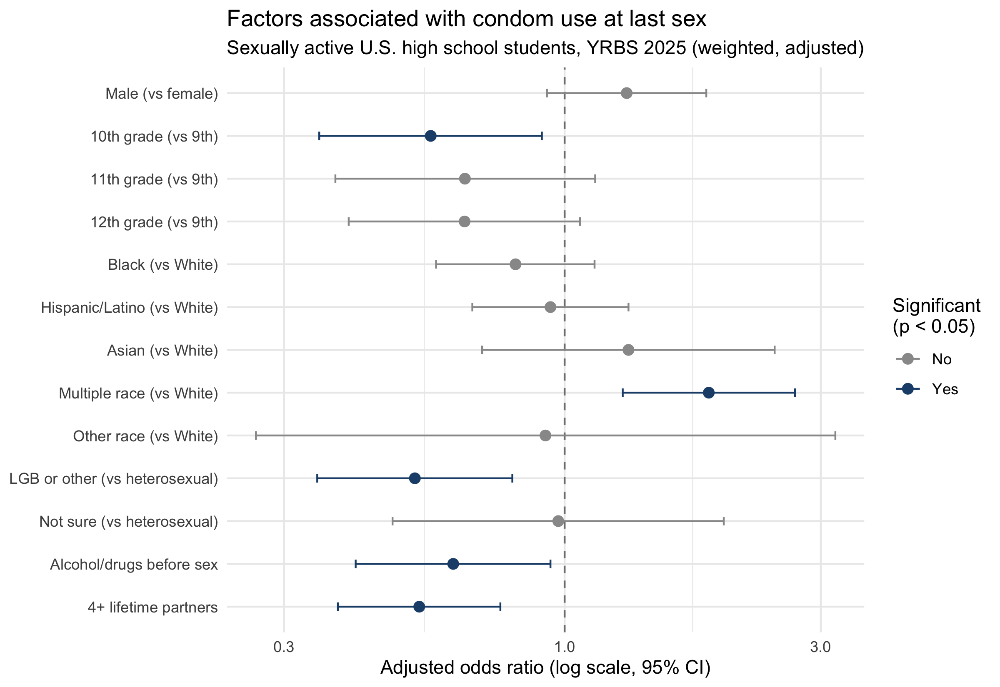

# Condom Use Among Sexually Active U.S. High School Students (YRBS 2025)

Which students are less likely to use condoms? This project analyzes the CDC's **2025 national Youth Risk Behavior Survey (YRBS)** to identify demographic and behavioral factors associated with condom use at last sexual intercourse among currently sexually active high school students, using survey-weighted methods so results represent U.S. high school students nationally.

## Key findings

- An estimated **53.0%** of currently sexually active high school students used a condom during last sexual intercourse (95% CI: 49.3% to 56.7%). The unweighted sample percentage was 50.2%, which shows why survey weights matter.
- After adjusting for all factors in the model, condom use was less likely among students who:
  - had **four or more lifetime partners** (adjusted OR 0.54, 95% CI 0.38 to 0.76)
  - identified as **lesbian, gay, bisexual, or another non-heterosexual identity** (aOR 0.53, 0.35 to 0.80)
  - **drank alcohol or used drugs before last sex** (aOR 0.62, 0.41 to 0.94)
- Males reported higher condom use than females (56.5% vs 49.3%), but the difference was borderline in cross-tabs (p = 0.052) and not significant after adjustment (aOR 1.31, 0.93 to 1.84).



## Data

- **Source:** CDC Youth Risk Behavior Survey, 2025 national high school dataset (10,710 students in grades 9 to 12), publicly available at [cdc.gov/yrbs/data](https://www.cdc.gov/yrbs/data/index.html).
- **Analysis sample:** 1,842 currently sexually active students (sexual intercourse with at least one person in the past 3 months); 1,608 with complete data for the regression.
- Raw data files are not included in this repository. Download the 2025 national **ASCII data file** and **SAS Input Program** into `data/` to reproduce the analysis.

## Methods

1. **Reading the data:** the CDC distributes YRBS as a fixed-width text file. `R/01_read_and_clean.R` builds the column map from the CDC's SAS input program and reads the file with `readr::read_fwf`.
2. **Recoding:** outcome = condom use at last sex (yes/no). Predictors: sex, grade, race/ethnicity, sexual identity, alcohol or drug use before last sex, and four or more lifetime partners. Small race/ethnicity groups (American Indian/Alaska Native, Middle Eastern/North African, Native Hawaiian/Pacific Islander) were combined into "Other" for stable estimates.
3. **Survey design:** all estimates use the YRBS sampling weights, strata, and primary sampling units (`survey` package). The sexually active subgroup is defined *within* the full design so standard errors reflect the full sampling structure.
4. **Analysis:** weighted prevalence with 95% CIs, design-adjusted (Rao-Scott) chi-square tests, and survey-weighted logistic regression (quasibinomial) reported as adjusted odds ratios.
5. **Missing data:** complete-case analysis. The most frequently skipped item among sexually active students was alcohol or drug use before sex (9.6%); all others were under 2% (`results/missingness_sexually_active.csv`).

## Results tables

- `results/table1_condom_use_by_factor.csv`: weighted % condom use by group, 95% CI, unweighted n, and chi-square p-value
- `results/table2_adjusted_odds_ratios.csv`: adjusted odds ratios from the logistic regression
- `results/missingness_sexually_active.csv`: missing values per variable among sexually active students

## Limitations

- Self-reported behaviors may be affected by recall or reluctance to report sensitive topics.
- Cross-sectional data show associations, not causes.
- Complete-case analysis may introduce bias if students who skipped the alcohol/drug question differ from those who answered.
- Small groups (Asian, "Other" race; fewer than 50 students) have unstable estimates with wide confidence intervals.
- Only students attending school are surveyed, and condom use is measured only at last sex.

## How to run

Requires R with `readr`, `dplyr`, `survey`, and `ggplot2`. From the repository root, after placing the CDC files in `data/`:

```r
source("R/01_read_and_clean.R")   # read fixed-width file, recode, missingness check
source("R/02_analysis.R")         # survey design, tables, regression, figure
```

## Repository structure

```
R/
  01_read_and_clean.R   read the CDC fixed-width file and build analysis variables
  02_analysis.R         survey-weighted prevalence, chi-square tests, logistic regression, figure
results/                CSV tables behind every number above
figures/                forest plot of adjusted odds ratios
```

## Author

Stephanie Galvis, MS Bioinformatics, Brandeis University
